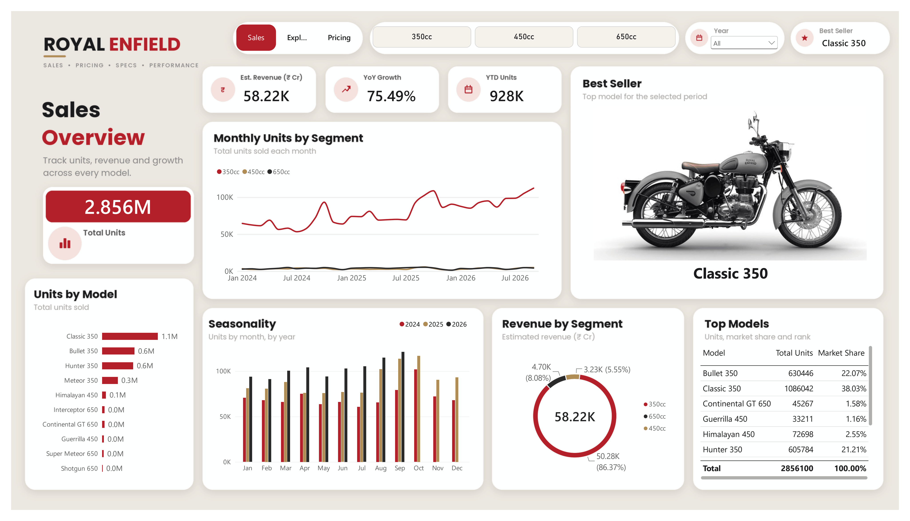
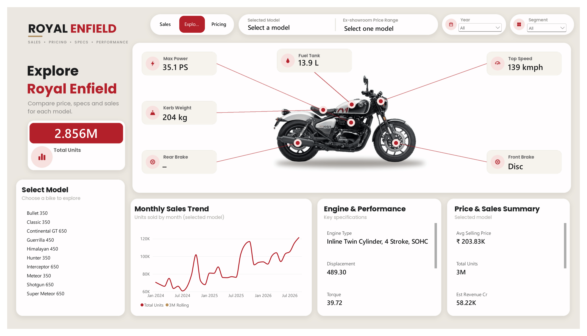
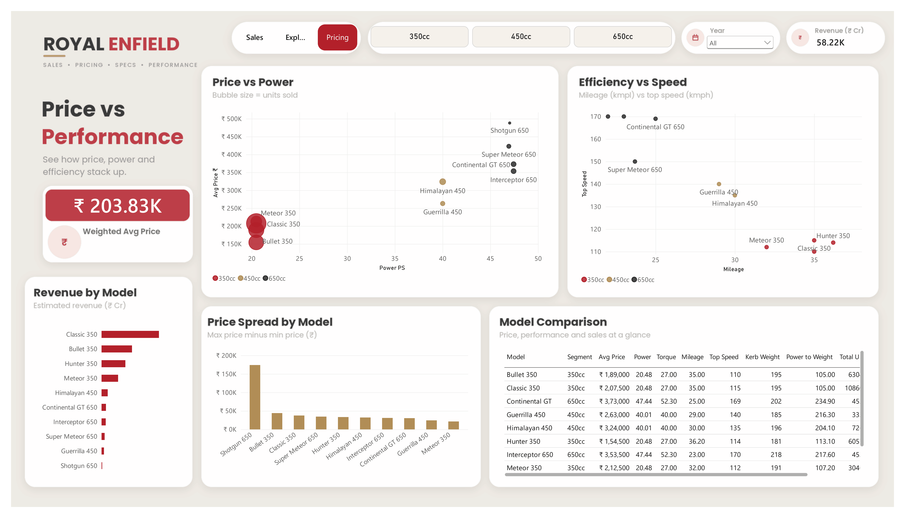

# Royal Enfield Sales & Bike Analysis

An Excel and Power BI project exploring Royal Enfield monthly model sales, bike prices, and specifications. The sales data covers January 2024 to September 2026. The project includes Excel preprocessing and checks, two Python scrapers for bike data, and an interactive three-page Power BI dashboard.

## Business questions answered

1. **Which models drive sales and revenue?** Classic 350 leads, with about 38% of units and 39% of estimated revenue.
2. **How are sales trending, and when do they peak?** October is the peak month in both 2024 and 2025, likely due to festive-season demand. 2026 data runs through September.
3. **Which segments earn the most?** The four 350cc models account for about 92% of volume and the largest estimated revenue share (about 86%). The 650cc models contribute about 4% of units and 8% of estimated revenue.
4. **Which models are growing or declining?** Guerrilla 450 sales rise from 8,526 (2024) to 10,986 (2025) to 13,699 (January-September 2026). Himalayan 450 falls from 28,727 to 24,833 to 19,138 over the same periods; Super Meteor 650 also declines.
5. **How do price and performance compare?** The Pricing page compares price with power, mileage and top speed, and compares power-to-weight and price spread across models.

## Key findings

- Classic 350 is the leading model by volume and estimated revenue.
- October is the observed peak month in 2024 and 2025.
- The four 350cc models dominate volume; the 650cc models contribute a smaller share of units but a larger share of estimated revenue.
- Guerrilla 450 sales increase across the periods shown, while Himalayan 450 and Super Meteor 650 decline.
- Shotgun 650 has the lowest sales and widest price spread.

## Dashboard

The Power BI report has synced Year and Segment slicers and three pages: Sales, Explorer, and Pricing.

### Sales overview



### Bike Explorer



### Pricing and performance



Open [dashboard.pbix](4-power-bi-dashboard/dashboard.pbix) in Power BI Desktop to interact with the report.

## Data and workflow

### 1. Data collection

- Monthly model sales were manually collected from [RushLane's Royal Enfield coverage](https://www.rushlane.com/category/bikes-news/royal-enfield-bikes) for January 2024-September 2026.
- The price and specification scrapers collect data from [91Wheels' Royal Enfield listings](https://www.91wheels.com/bikes/royalenfield).
- The specification scraper targets the base variant for each of 10 models. Unavailable source fields can remain blank in its output.

### 2. Excel preprocessing

**Sales** - `3-cleaned-data/sales_cleaned.xlsm`

- Preserves the 33 raw monthly rows in `Raw_Backup`; these match the input sales workbook.
- Replaces en dash placeholders with blanks, standardizes model names, and splits combined `650 Twins` sales 50/50 between Interceptor 650 and Continental GT 650.
- Adds Year and Month Name fields. The cleaned model data totals 2,856,100 units, matching the raw total.
- Includes `Sales_Clean`, `Analysis`, `Pivot`, `Assumptions`, and `Checks` sheets. Checks cover dates, month gaps, duplicates, negatives, and totals. Analysis uses Excel formulas including SUM, INDEX/MATCH, SUMIFS, COUNTIFS, SUMPRODUCT, RANK, and MoM/YoY calculations.
- Includes the `HighlightSalesOutliers` VBA macro, which flags IQR outliers in columns B:K of `Sales_Clean`.

**Prices and specifications** - `3-cleaned-data/bike_master_cleaned.xlsm`

- Combines the 10-model price and specification inputs into `Bike_Master`; retains input and merged source data in `Prices_Raw`, `Specs_Raw`, and `Bike_Merged_Raw`.
- The price values match the raw price input. Specification text was standardized and displacement rounded (for example, 349.34cc to 349cc).
- Some missing specification values were manually filled or checked against sources. The workbook's `Checks` sheet notes manually filled engine types for Continental GT 650, Guerrilla 450, and Shotgun 650, and manual mileage/top-speed verification.
- Adds average price, price spread, segment, power-to-weight, and data notes. The `HighlightBikeOutliers` VBA macro flags IQR outliers in selected `Bike_Master` columns.
- Includes checks for matching models, blanks, errors, duplicates, and values against the raw inputs.

### 3. Power BI

- Loads `Fact_Sales` (317 unpivoted rows), `Dim_Bike` (10 models), and a DAX-created `Dim_Date`.
- Uses a star schema with one-to-many relationships for date and model.
- Includes measures for Total Units, Market Share, Model Rank, Top Model, Festive Units, PY Units, YoY%, YTD, 3M Rolling, MoM%, Est Revenue, Avg Selling Price, and Explorer-page text.
- The three pages show sales KPIs and trends, selected-model specifications and sales, and price/performance comparisons.
- The report was styled with the supplied theme, page templates, and transparent Explorer callout overlay.

## Assumptions and limitations

- Interceptor 650 and Continental GT 650 sales are split 50/50 from the combined `650 Twins` sales.
- Estimated revenue uses average ex-showroom prices of base variants. It is an estimate, not reported revenue.
- 2026 sales cover January to September, so 2026 figures are year-to-date and not directly comparable with full-year totals.
- Scraped prices and specifications reflect the source pages at collection time and may change.

## Project structure

```text
README.md
raw _readme.txt
1-raw-data-collection/
  scraper/
    royal_enfield_prices_scraper.py
    royal_enfield_scraper.py
    requirements.txt
    venv/  (local Python environment)
    output/
      Royal_Enfield_Prices.csv
      Royal_Enfield_Prices.xlsx
      Royal_Enfield_Bike_Specifications.csv
      Royal_Enfield_Bike_Specifications.xlsx
2-raw-data/
  monthly_model_sales_raw.xlsx
  bike_price_raw.xlsx
  bike_specifications_raw.xlsx
3-cleaned-data/
  sales_cleaned.xlsm
  bike_master_cleaned.xlsm
4-power-bi-dashboard/
  dashboard.pbix
  RE_Dashboard_Theme.json
  templates/
    RE_Page1_Sales_Overview.png
    RE_Page2_Bike_Explorer.png
    RE_Page2_Hero_Overlay.png
    RE_Page3_Price_vs_Performance.png
  screenshots/
    page-1-sales.png
    page-2-explorer.png
    page-3-pricing.png
```

The local `venv/` is an environment folder, not required project data. The scraper scripts write generated CSV and Excel files beside the scripts; the existing exported copies are in `scraper/output/`.

## Running the scrapers

From the project root in PowerShell:

```powershell
cd 1-raw-data-collection\scraper
python -m venv .venv
.\.venv\Scripts\Activate.ps1
python -m pip install -r requirements.txt
python -m playwright install chromium
python royal_enfield_prices_scraper.py
python royal_enfield_scraper.py
```

The scripts use Playwright with Chromium, BeautifulSoup, pandas, and openpyxl. Running them requires internet access to the source site. The Excel `.xlsm` files require Excel with macros enabled to run the VBA procedures.
